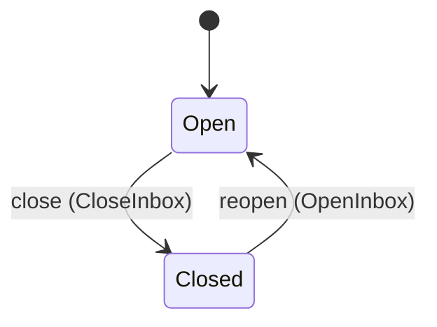
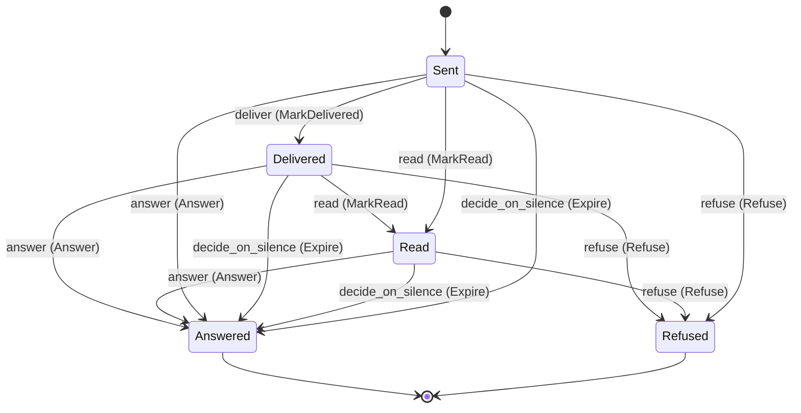

<!--
generated from inbox v1
contract digest slice-sha256/2:b2752e02fb814efe015dd697c394e9b35780af59421c2491cff5e6943b6603b5
do not edit: regenerate with `ess generate`
-->

# Messaging

One addressable inbox per agent or person, and the messages that wait in them. A message is one signed envelope for one inbox. The service keeps it until it is handled or its `expires` passes, then removes it; nothing is kept as history.

`inbox.messaging` is one of inbox's bounded contexts. [Back to the index](../index.md).

## Types

### `Adapter`

`inbox.messaging.Adapter` is one of `claude_code`, `metaharness`, `slack` and `terminal`.

### `Address`

`inbox.messaging.Address` wraps `String` and is not interchangeable with one: the whole value of naming it separately is the crossings the model then refuses.

### `AnsweredBy`

`inbox.messaging.AnsweredBy` is one of `principal` and `silence`.

### `Body`

`inbox.messaging.Body` wraps `String` and is not interchangeable with one: the whole value of naming it separately is the crossings the model then refuses. Every value satisfies `value.utf8_bytes <= 65536`.

### `DecisionAsk`

`inbox.messaging.DecisionAsk` is a record of three fields:

- `options` — `List<inbox.messaging.DecisionOption>`
- `recommended_option` — `Optional<inbox.messaging.OptionLetter>`, which may be absent
- `request_ref` — `Optional<String>`, which may be absent

### `DecisionOption`

`inbox.messaging.DecisionOption` is a record of two fields:

- `letter` — `inbox.messaging.OptionLetter`
- `text` — `String`

### `DedupKey`

`inbox.messaging.DedupKey` wraps `String` and is not interchangeable with one: the whole value of naming it separately is the crossings the model then refuses.

### `DelegationEntry`

`inbox.messaging.DelegationEntry` is a record of five fields:

- `delegation_id` — `inbox.messaging.DelegationId`
- `agent` — `inbox.messaging.Principal`
- `on_behalf_of` — `inbox.messaging.Principal`
- `valid_until` — `Timestamp`
- `operator_signature` — `String`

### `DelegationId`

`inbox.messaging.DelegationId` wraps `String` and is not interchangeable with one: the whole value of naming it separately is the crossings the model then refuses.

### `FreeShape`

`inbox.messaging.FreeShape` is a record of no fields:

### `KeyEntry`

`inbox.messaging.KeyEntry` is a record of five fields:

- `key_id` — `String`
- `principal` — `inbox.messaging.Principal`
- `public_key` — `String`
- `valid_until` — `Timestamp`
- `operator_signature` — `String`

### `KeyFile`

`inbox.messaging.KeyFile` is a record of two fields:

- `keys` — `List<inbox.messaging.KeyEntry>`
- `delegations` — `List<inbox.messaging.DelegationEntry>`

### `Kind`

`inbox.messaging.Kind` is one of `note`, `request` and `decision`.

### `MessageId`

`inbox.messaging.MessageId` wraps `String` and is not interchangeable with one: the whole value of naming it separately is the crossings the model then refuses. Its characters are drawn from `0123456789ABCDEFGHJKMNPQRSTVWXYZ`. Every value satisfies `value.count == 26`.

### `OptionLetter`

`inbox.messaging.OptionLetter` wraps `String` and is not interchangeable with one: the whole value of naming it separately is the crossings the model then refuses. Its characters are drawn from `ABCDEFGHIJKLMNOPQRSTUVWXYZ`. Every value satisfies `value.count == 1`.

### `Principal`

`inbox.messaging.Principal` wraps `String` and is not interchangeable with one: the whole value of naming it separately is the crossings the model then refuses.

### `Reply`

`inbox.messaging.Reply` is a record of eight fields:

- `reply_id` — `inbox.messaging.MessageId`
- `from` — `inbox.messaging.Principal`
- `on_behalf_of` — `inbox.messaging.Principal`
- `authority` — `Optional<inbox.messaging.DelegationId>`, which may be absent
- `created` — `Timestamp`
- `option` — `Optional<inbox.messaging.OptionLetter>`, which may be absent
- `body` — `inbox.messaging.Body`
- `signature` — `inbox.messaging.Signature`

### `ReplyShape`

`inbox.messaging.ReplyShape` is one of three shapes, told apart by a `shape` field — tagged, so a decoder never has to guess which branch it is reading:

- `free` — `inbox.messaging.FreeShape`
- `lines` — `Integer`
- `schema` — `String`

### `Signature`

`inbox.messaging.Signature` is a record of two fields:

- `key_id` — `String`
- `value` — `String`

### `ThreadId`

`inbox.messaging.ThreadId` wraps `String` and is not interchangeable with one: the whole value of naming it separately is the crossings the model then refuses. Its characters are drawn from `0123456789ABCDEFGHJKMNPQRSTVWXYZ`. Every value satisfies `value.count == 26`.

One of the types above is reached by nothing else in this system: `inbox.messaging.KeyFile`. No entity, view, command, event, error or crossing names it, so it is either vocabulary something outside this specification uses or a leftover — and only a person can tell which.

## Entities

An entity is what this context is about: something with an identity that outlives any one request, a shape, and a lifecycle. The lifecycle is exhaustive — a move that is not drawn below is a move this specification does not permit, and that is the only way it says so. Every move is labelled with the command that takes it, because a move nothing can trigger is refused rather than drawn.

### `Inbox`

`inbox.messaging.Inbox`.

An instance is identified by `address`, a `inbox.messaging.Address`. The name is part of the model and not a convention: a view projects the identity under that name, so a projection inventing its own would disagree with the view.

It holds:

- `owner` — `inbox.messaging.Principal`
- `adapter` — `inbox.messaging.Adapter`

It declares no relation to another entity, and no other entity names it.

No invariant is declared, so nothing here constrains an instance at rest.

Its state is a `inbox.messaging.Inbox.State`, one of `Closed` and `Open`. That enum is synthesised from the lifecycle rather than declared beside it, so the states a view's filter compares and the states drawn below cannot disagree.

An instance is created in `Open`. No state is terminal: nothing in this lifecycle says an instance may stop moving.

Each move is taken by a declared command outcome, and a move nothing takes is refused as `missing_causation` rather than left as a state change nobody can trigger:

- `close` — taken by `inbox.messaging.CloseInbox` on its `closed` outcome
- `reopen` — taken by `inbox.messaging.OpenInbox` on its `reopened` outcome

An instance is brought into existence by `inbox.messaging.OpenInbox` on its `opened` outcome.

Every ordered pair of these states is connected by some move, so this lifecycle forbids nothing.

One view projects it: [`Inboxes`](#inboxes).

### `Message`

`inbox.messaging.Message`.

An instance is identified by `message_id`, a `inbox.messaging.MessageId`. The name is part of the model and not a convention: a view projects the identity under that name, so a projection inventing its own would disagree with the view.

It holds:

- `from` — `inbox.messaging.Principal`
- `on_behalf_of` — `inbox.messaging.Principal`
- `authority` — `Optional<inbox.messaging.DelegationId>`, which may be absent
- `to` — `inbox.messaging.Address`
- `kind` — `inbox.messaging.Kind`
- `thread` — `inbox.messaging.ThreadId`
- `reply_shape` — `Optional<inbox.messaging.ReplyShape>`, which may be absent
- `decision` — `Optional<inbox.messaging.DecisionAsk>`, which may be absent
- `default_on_silence` — `Optional<inbox.messaging.OptionLetter>`, which may be absent
- `created` — `Timestamp`
- `expires` — `Timestamp`
- `dedup_key` — `inbox.messaging.DedupKey`
- `body` — `inbox.messaging.Body`
- `signature` — `inbox.messaging.Signature`
- `answered_by` — `Optional<inbox.messaging.AnsweredBy>`, which may be absent
- `decided_option` — `Optional<inbox.messaging.OptionLetter>`, which may be absent
- `reply` — `Optional<inbox.messaging.Reply>`, which may be absent
- `refusal` — `Optional<String>`, which may be absent

It references at most one [`Inbox`](#inbox), as `inbox`, carried by `Message.to`.

No invariant is declared, so nothing here constrains an instance at rest.

Its state is a `inbox.messaging.Message.State`, one of `Answered`, `Delivered`, `Read`, `Refused` and `Sent`. That enum is synthesised from the lifecycle rather than declared beside it, so the states a view's filter compares and the states drawn below cannot disagree.

An instance is created in `Sent`. `Answered` and `Refused` are terminal, so an instance may rest there forever. That is declared rather than inferred from having no way out: an entity that cannot leave a state is either finished or stuck, and only its author knows which.

Each move is taken by a declared command outcome, and a move nothing takes is refused as `missing_causation` rather than left as a state change nobody can trigger:

- `deliver` — taken by `inbox.messaging.MarkDelivered` on its `delivered` outcome
- `read` — taken by `inbox.messaging.MarkRead` on its `read` outcome
- `answer` — taken by `inbox.messaging.Answer` on its `answered` outcome
- `decide_on_silence` — taken by `inbox.messaging.Expire` on its `decided-on-silence` outcome
- `refuse` — taken by `inbox.messaging.Refuse` on its `refused` outcome

An instance is brought into existence by `inbox.messaging.PostMessage` on its `posted` outcome.

Illegal transitions are illegal by absence: no rule forbids them, there is simply no arrow, because a rule would be a second place for the same truth to live. A diagram cannot show an absence, so the pairs it does not connect are listed here, derived from the same transitions — anything named below is a move this specification does not permit.

- `Answered` may not become `Delivered`
- `Answered` may not become `Read`
- `Answered` may not become `Refused`
- `Answered` may not become `Sent`
- `Delivered` may not become `Sent`
- `Read` may not become `Delivered`
- `Read` may not become `Sent`
- `Refused` may not become `Answered`
- `Refused` may not become `Delivered`
- `Refused` may not become `Read`
- `Refused` may not become `Sent`

Eight views project it: [`Due`](#due), [`Messages`](#messages), [`Outbox`](#outbox), [`Pending`](#pending), [`Replies`](#replies), [`Settled`](#settled), [`Thread`](#thread) and [`Unanswered`](#unanswered).

## Views

A view is what the outside world is promised it can observe. Each one says which instances it contains and how soon it reflects a command that has already returned, because "you can read this" without "how soon" is the promise every flaky suite is built on.

### `Due`

`inbox.messaging.Due`, shown to a person as "Due" and called `due` on the wire.

It reads [`Message`](#message).

It contains the instances where `expires <= param.now as timestamp` holds, and only those — so an instance a caller cannot find in here has been filtered out rather than lost.

It exposes:

- `message_id` — `inbox.messaging.MessageId`
- `from` — `inbox.messaging.Principal`
- `on_behalf_of` — `inbox.messaging.Principal`
- `authority` — `Optional<inbox.messaging.DelegationId>`, which may be absent
- `to` — `inbox.messaging.Address`
- `kind` — `inbox.messaging.Kind`
- `thread` — `inbox.messaging.ThreadId`
- `reply_shape` — `Optional<inbox.messaging.ReplyShape>`, which may be absent
- `decision` — `Optional<inbox.messaging.DecisionAsk>`, which may be absent
- `default_on_silence` — `Optional<inbox.messaging.OptionLetter>`, which may be absent
- `created` — `Timestamp`
- `expires` — `Timestamp`
- `dedup_key` — `inbox.messaging.DedupKey`
- `body` — `inbox.messaging.Body`
- `signature` — `inbox.messaging.Signature`
- `answered_by` — `Optional<inbox.messaging.AnsweredBy>`, which may be absent
- `decided_option` — `Optional<inbox.messaging.OptionLetter>`, which may be absent
- `reply` — `Optional<inbox.messaging.Reply>`, which may be absent
- `refusal` — `Optional<String>`, which may be absent
- `state` — `inbox.messaging.Message.State`

It declares no order, so the rows come back in whatever order the implementation has, and two reads may disagree.

**Read-your-writes**: it is current the moment the command that changed it returns. A caller that has just created an invoice and cannot see it in here has been told a lie about what it did.

A generated scenario asserts it once, immediately after the command: a view promising this and not keeping the promise has to fail the suite rather than be retried until it passes.

### `Inboxes`

`inbox.messaging.Inboxes`, shown to a person as "Inboxes" and called `inboxes` on the wire.

It reads [`Inbox`](#inbox).

It contains every instance of that entity: no filter narrows it, which is a decision somebody made and not a line somebody omitted.

It exposes:

- `address` — `inbox.messaging.Address`
- `owner` — `inbox.messaging.Principal`
- `adapter` — `inbox.messaging.Adapter`
- `state` — `inbox.messaging.Inbox.State`

It declares no order, so the rows come back in whatever order the implementation has, and two reads may disagree.

**Read-your-writes**: it is current the moment the command that changed it returns. A caller that has just created an invoice and cannot see it in here has been told a lie about what it did.

A generated scenario asserts it once, immediately after the command: a view promising this and not keeping the promise has to fail the suite rather than be retried until it passes.

### `Messages`

`inbox.messaging.Messages`, shown to a person as "Messages" and called `messages` on the wire.

It reads [`Message`](#message).

It contains every instance of that entity: no filter narrows it, which is a decision somebody made and not a line somebody omitted.

It exposes:

- `message_id` — `inbox.messaging.MessageId`
- `from` — `inbox.messaging.Principal`
- `on_behalf_of` — `inbox.messaging.Principal`
- `authority` — `Optional<inbox.messaging.DelegationId>`, which may be absent
- `to` — `inbox.messaging.Address`
- `kind` — `inbox.messaging.Kind`
- `thread` — `inbox.messaging.ThreadId`
- `reply_shape` — `Optional<inbox.messaging.ReplyShape>`, which may be absent
- `decision` — `Optional<inbox.messaging.DecisionAsk>`, which may be absent
- `default_on_silence` — `Optional<inbox.messaging.OptionLetter>`, which may be absent
- `created` — `Timestamp`
- `expires` — `Timestamp`
- `dedup_key` — `inbox.messaging.DedupKey`
- `body` — `inbox.messaging.Body`
- `signature` — `inbox.messaging.Signature`
- `answered_by` — `Optional<inbox.messaging.AnsweredBy>`, which may be absent
- `decided_option` — `Optional<inbox.messaging.OptionLetter>`, which may be absent
- `reply` — `Optional<inbox.messaging.Reply>`, which may be absent
- `refusal` — `Optional<String>`, which may be absent
- `state` — `inbox.messaging.Message.State`

It declares no order, so the rows come back in whatever order the implementation has, and two reads may disagree.

**Read-your-writes**: it is current the moment the command that changed it returns. A caller that has just created an invoice and cannot see it in here has been told a lie about what it did.

A generated scenario asserts it once, immediately after the command: a view promising this and not keeping the promise has to fail the suite rather than be retried until it passes.

### `Outbox`

`inbox.messaging.Outbox`, shown to a person as "Outbox" and called `outbox` on the wire.

It reads [`Message`](#message).

It contains the instances where `from == param.sender` holds, and only those — so an instance a caller cannot find in here has been filtered out rather than lost.

It exposes:

- `message_id` — `inbox.messaging.MessageId`
- `from` — `inbox.messaging.Principal`
- `on_behalf_of` — `inbox.messaging.Principal`
- `authority` — `Optional<inbox.messaging.DelegationId>`, which may be absent
- `to` — `inbox.messaging.Address`
- `kind` — `inbox.messaging.Kind`
- `thread` — `inbox.messaging.ThreadId`
- `reply_shape` — `Optional<inbox.messaging.ReplyShape>`, which may be absent
- `decision` — `Optional<inbox.messaging.DecisionAsk>`, which may be absent
- `default_on_silence` — `Optional<inbox.messaging.OptionLetter>`, which may be absent
- `created` — `Timestamp`
- `expires` — `Timestamp`
- `dedup_key` — `inbox.messaging.DedupKey`
- `body` — `inbox.messaging.Body`
- `signature` — `inbox.messaging.Signature`
- `answered_by` — `Optional<inbox.messaging.AnsweredBy>`, which may be absent
- `decided_option` — `Optional<inbox.messaging.OptionLetter>`, which may be absent
- `reply` — `Optional<inbox.messaging.Reply>`, which may be absent
- `refusal` — `Optional<String>`, which may be absent
- `state` — `inbox.messaging.Message.State`

It declares no order, so the rows come back in whatever order the implementation has, and two reads may disagree.

**Read-your-writes**: it is current the moment the command that changed it returns. A caller that has just created an invoice and cannot see it in here has been told a lie about what it did.

A generated scenario asserts it once, immediately after the command: a view promising this and not keeping the promise has to fail the suite rather than be retried until it passes.

### `Pending`

`inbox.messaging.Pending`, shown to a person as "Pending" and called `pending` on the wire.

It reads [`Message`](#message).

It contains the instances where `(to == param.inbox and (state == Sent or state == Delivered))` holds, and only those — so an instance a caller cannot find in here has been filtered out rather than lost.

It exposes:

- `message_id` — `inbox.messaging.MessageId`
- `from` — `inbox.messaging.Principal`
- `on_behalf_of` — `inbox.messaging.Principal`
- `authority` — `Optional<inbox.messaging.DelegationId>`, which may be absent
- `to` — `inbox.messaging.Address`
- `kind` — `inbox.messaging.Kind`
- `thread` — `inbox.messaging.ThreadId`
- `reply_shape` — `Optional<inbox.messaging.ReplyShape>`, which may be absent
- `decision` — `Optional<inbox.messaging.DecisionAsk>`, which may be absent
- `default_on_silence` — `Optional<inbox.messaging.OptionLetter>`, which may be absent
- `created` — `Timestamp`
- `expires` — `Timestamp`
- `dedup_key` — `inbox.messaging.DedupKey`
- `body` — `inbox.messaging.Body`
- `signature` — `inbox.messaging.Signature`
- `state` — `inbox.messaging.Message.State`

It declares no order, so the rows come back in whatever order the implementation has, and two reads may disagree.

**Read-your-writes**: it is current the moment the command that changed it returns. A caller that has just created an invoice and cannot see it in here has been told a lie about what it did.

A generated scenario asserts it once, immediately after the command: a view promising this and not keeping the promise has to fail the suite rather than be retried until it passes.

### `Replies`

`inbox.messaging.Replies`, shown to a person as "Replies" and called `replies` on the wire.

It reads [`Message`](#message).

It contains the instances where `(thread == param.thread and state == Answered)` holds, and only those — so an instance a caller cannot find in here has been filtered out rather than lost.

It exposes:

- `message_id` — `inbox.messaging.MessageId`
- `from` — `inbox.messaging.Principal`
- `on_behalf_of` — `inbox.messaging.Principal`
- `authority` — `Optional<inbox.messaging.DelegationId>`, which may be absent
- `to` — `inbox.messaging.Address`
- `kind` — `inbox.messaging.Kind`
- `thread` — `inbox.messaging.ThreadId`
- `reply_shape` — `Optional<inbox.messaging.ReplyShape>`, which may be absent
- `decision` — `Optional<inbox.messaging.DecisionAsk>`, which may be absent
- `default_on_silence` — `Optional<inbox.messaging.OptionLetter>`, which may be absent
- `created` — `Timestamp`
- `expires` — `Timestamp`
- `dedup_key` — `inbox.messaging.DedupKey`
- `body` — `inbox.messaging.Body`
- `signature` — `inbox.messaging.Signature`
- `answered_by` — `Optional<inbox.messaging.AnsweredBy>`, which may be absent
- `decided_option` — `Optional<inbox.messaging.OptionLetter>`, which may be absent
- `reply` — `Optional<inbox.messaging.Reply>`, which may be absent
- `state` — `inbox.messaging.Message.State`

It declares no order, so the rows come back in whatever order the implementation has, and two reads may disagree.

**Read-your-writes**: it is current the moment the command that changed it returns. A caller that has just created an invoice and cannot see it in here has been told a lie about what it did.

A generated scenario asserts it once, immediately after the command: a view promising this and not keeping the promise has to fail the suite rather than be retried until it passes.

### `Settled`

`inbox.messaging.Settled`, shown to a person as "Settled" and called `settled` on the wire.

It reads [`Message`](#message).

It contains the instances where `(from == param.sender and (state == Answered or state == Refused))` holds, and only those — so an instance a caller cannot find in here has been filtered out rather than lost.

It exposes:

- `message_id` — `inbox.messaging.MessageId`
- `from` — `inbox.messaging.Principal`
- `on_behalf_of` — `inbox.messaging.Principal`
- `authority` — `Optional<inbox.messaging.DelegationId>`, which may be absent
- `to` — `inbox.messaging.Address`
- `kind` — `inbox.messaging.Kind`
- `thread` — `inbox.messaging.ThreadId`
- `reply_shape` — `Optional<inbox.messaging.ReplyShape>`, which may be absent
- `decision` — `Optional<inbox.messaging.DecisionAsk>`, which may be absent
- `default_on_silence` — `Optional<inbox.messaging.OptionLetter>`, which may be absent
- `created` — `Timestamp`
- `expires` — `Timestamp`
- `dedup_key` — `inbox.messaging.DedupKey`
- `body` — `inbox.messaging.Body`
- `signature` — `inbox.messaging.Signature`
- `answered_by` — `Optional<inbox.messaging.AnsweredBy>`, which may be absent
- `decided_option` — `Optional<inbox.messaging.OptionLetter>`, which may be absent
- `reply` — `Optional<inbox.messaging.Reply>`, which may be absent
- `refusal` — `Optional<String>`, which may be absent
- `state` — `inbox.messaging.Message.State`

It declares no order, so the rows come back in whatever order the implementation has, and two reads may disagree.

**Read-your-writes**: it is current the moment the command that changed it returns. A caller that has just created an invoice and cannot see it in here has been told a lie about what it did.

A generated scenario asserts it once, immediately after the command: a view promising this and not keeping the promise has to fail the suite rather than be retried until it passes.

### `Thread`

`inbox.messaging.Thread`, shown to a person as "Thread" and called `thread` on the wire.

It reads [`Message`](#message).

It contains the instances where `thread == param.thread` holds, and only those — so an instance a caller cannot find in here has been filtered out rather than lost.

It exposes:

- `message_id` — `inbox.messaging.MessageId`
- `from` — `inbox.messaging.Principal`
- `on_behalf_of` — `inbox.messaging.Principal`
- `authority` — `Optional<inbox.messaging.DelegationId>`, which may be absent
- `to` — `inbox.messaging.Address`
- `kind` — `inbox.messaging.Kind`
- `thread` — `inbox.messaging.ThreadId`
- `reply_shape` — `Optional<inbox.messaging.ReplyShape>`, which may be absent
- `decision` — `Optional<inbox.messaging.DecisionAsk>`, which may be absent
- `default_on_silence` — `Optional<inbox.messaging.OptionLetter>`, which may be absent
- `created` — `Timestamp`
- `expires` — `Timestamp`
- `dedup_key` — `inbox.messaging.DedupKey`
- `body` — `inbox.messaging.Body`
- `signature` — `inbox.messaging.Signature`
- `answered_by` — `Optional<inbox.messaging.AnsweredBy>`, which may be absent
- `decided_option` — `Optional<inbox.messaging.OptionLetter>`, which may be absent
- `reply` — `Optional<inbox.messaging.Reply>`, which may be absent
- `refusal` — `Optional<String>`, which may be absent
- `state` — `inbox.messaging.Message.State`

It declares no order, so the rows come back in whatever order the implementation has, and two reads may disagree.

**Read-your-writes**: it is current the moment the command that changed it returns. A caller that has just created an invoice and cannot see it in here has been told a lie about what it did.

A generated scenario asserts it once, immediately after the command: a view promising this and not keeping the promise has to fail the suite rather than be retried until it passes.

### `Unanswered`

`inbox.messaging.Unanswered`, shown to a person as "Unanswered" and called `unanswered` on the wire.

It reads [`Message`](#message).

It contains the instances where `(to == param.inbox and state == Read)` holds, and only those — so an instance a caller cannot find in here has been filtered out rather than lost.

It exposes:

- `message_id` — `inbox.messaging.MessageId`
- `from` — `inbox.messaging.Principal`
- `on_behalf_of` — `inbox.messaging.Principal`
- `authority` — `Optional<inbox.messaging.DelegationId>`, which may be absent
- `to` — `inbox.messaging.Address`
- `kind` — `inbox.messaging.Kind`
- `thread` — `inbox.messaging.ThreadId`
- `reply_shape` — `Optional<inbox.messaging.ReplyShape>`, which may be absent
- `decision` — `Optional<inbox.messaging.DecisionAsk>`, which may be absent
- `default_on_silence` — `Optional<inbox.messaging.OptionLetter>`, which may be absent
- `created` — `Timestamp`
- `expires` — `Timestamp`
- `dedup_key` — `inbox.messaging.DedupKey`
- `body` — `inbox.messaging.Body`
- `signature` — `inbox.messaging.Signature`
- `state` — `inbox.messaging.Message.State`

It declares no order, so the rows come back in whatever order the implementation has, and two reads may disagree.

**Read-your-writes**: it is current the moment the command that changed it returns. A caller that has just created an invoice and cannot see it in here has been told a lie about what it did.

A generated scenario asserts it once, immediately after the command: a view promising this and not keeping the promise has to fail the suite rather than be retried until it passes.

## Commands

### `Answer`

`inbox.messaging.Answer`, called `answer` on the wire.

It takes:

- `in_reply_to` — `inbox.messaging.MessageId`
- `reply_id` — `inbox.messaging.MessageId`
- `from` — `inbox.messaging.Principal`
- `on_behalf_of` — `inbox.messaging.Principal`
- `authority` — `Optional<inbox.messaging.DelegationId>`, which may be absent
- `created` — `Timestamp`
- `expires` — `Timestamp`
- `option` — `Optional<inbox.messaging.OptionLetter>`, which may be absent
- `body` — `inbox.messaging.Body`
- `signature` — `inbox.messaging.Signature`

It has 12 outcomes.

**`not-sender`** — Taken when `from != caller.principal` holds of the input. No entity in this specification changes. It reports `inbox.messaging.NotSender`. It emits nothing. A test reaches it by constructing an input that satisfies that condition.

**`no-authority`** — Taken when `(on_behalf_of != {fact: from} and not (defined(authority)))` holds of the input. No entity in this specification changes. It reports `inbox.messaging.NoAuthority`. It emits nothing. A test reaches it by constructing an input that satisfies that condition.

**`already-expired`** — Taken when `expires <= {fact: created} as timestamp` holds of the input. No entity in this specification changes. It reports `inbox.messaging.AlreadyExpired`. It emits nothing. A test reaches it by constructing an input that satisfies that condition.

**`signature-invalid`** — Decided outside the input: the SignatureVerifier port does not know the key, finds it lapsed, or finds that the signature does not verify. No predicate over the input reaches this branch, and saying `when: false` instead would have claimed it is unreachable, which is a different and false statement. It is decided before the addressed row is read, among the input-guarded refusals: before existence and the held state. No entity in this specification changes. It reports `inbox.messaging.SignatureInvalid`. It emits nothing. A test reaches it by injecting the declared fault, because no input can.

**`authority-invalid`** — Decided outside the input: the SignatureVerifier port finds no live delegation with this id that lets `from` speak for `on_behalf_of`. No predicate over the input reaches this branch, and saying `when: false` instead would have claimed it is unreachable, which is a different and false statement. It is decided before the addressed row is read, among the input-guarded refusals: before existence and the held state. No entity in this specification changes. It reports `inbox.messaging.NoAuthority`. It emits nothing. A test reaches it by injecting the declared fault, because no input can.

**`unknown-message`** — Taken when the identity the command names is one no record carries, before any other answer for it. No entity in this specification changes. It reports `inbox.messaging.UnknownMessage`. It emits nothing. A test reaches it by sending an identity no record carries, arranging nothing.

**`foreign-message`** — The caller is neither the recipient nor the sender of the message. The service answers it as `unknown-message`, so from this command a third principal cannot tell a message between others from no message. Taken when the existing subject's stored fields satisfy `(to != caller.inbox and from != caller.principal)`. No entity in this specification changes. It reports `inbox.messaging.UnknownMessage`. It emits nothing. A test establishes and independently observes the subject enum fact before selecting this branch.

**`not-recipient`** — Taken when the existing subject's stored fields satisfy `to != caller.inbox`. No entity in this specification changes. It reports `inbox.messaging.NotRecipient`. It emits nothing. A test establishes and independently observes the subject enum fact before selecting this branch.

**`already-settled`** — Taken when the subject is resting in a state none of this command's moves start from — a `inbox.messaging.Message` in `Answered` and `Refused`, which is what is left of the lifecycle once this command's own moves are taken away. The document lists none of it. No entity in this specification changes. It reports `inbox.messaging.AlreadySettled`, carrying `state`. It emits nothing. A test reaches it by driving an instance into one of those states and then issuing the command, because no input selects this branch.

**`note`** — Taken when the existing subject's stored fields satisfy `kind == note`. No entity in this specification changes. It reports `inbox.messaging.NotAnswerable`. It emits nothing. A test establishes and independently observes the subject enum fact before selecting this branch.

**`shape-mismatch`** — Decided outside the input: the reply does not fit the message's `reply_shape`, or names no option of the decision. No predicate over the input reaches this branch, and saying `when: false` instead would have claimed it is unreachable, which is a different and false statement. No entity in this specification changes. It reports `inbox.messaging.ShapeMismatch`. It emits nothing. A test reaches it by injecting the declared fault, because no input can.

**`answered`** — The default branch, taken when no other outcome's condition matched. It moves a `inbox.messaging.Message` from `Delivered`, `Read` and `Sent` to `Answered`, along the declared move `answer`. The instance is the one named by the input field `in_reply_to`. It emits `inbox.messaging.MessageAnswered`. It sets `expires` from `input.expires`, `answered_by` from `"principal"`, `decided_option` from `input.option` and `reply` from `{reply_id: input.reply_id, from: input.from, on_behalf_of: input.on_behalf_of, authority: input.authority, created: input.created, option: input.option, body: input.body, signature: input.signature}`. A test reaches it by constructing an input that satisfies no other outcome's condition.

### `CloseInbox`

`inbox.messaging.CloseInbox`, called `close-inbox` on the wire.

It takes:

- `address` — `inbox.messaging.Address`

It has four outcomes.

**`unknown-inbox`** — Taken when the identity the command names is one no record carries, before any other answer for it. No entity in this specification changes. It reports `inbox.messaging.UnknownInbox`. It emits nothing. A test reaches it by sending an identity no record carries, arranging nothing.

**`not-owner`** — Taken when the existing subject's stored fields satisfy `owner != caller.principal`. No entity in this specification changes. It reports `inbox.messaging.NotRecipient`. It emits nothing. A test establishes and independently observes the subject enum fact before selecting this branch.

**`closed`** — Taken when the existing subject is in Open. It moves a `inbox.messaging.Inbox` from `Open` to `Closed`, along the declared move `close`. The instance is the one named by the input field `address`. It emits `inbox.messaging.InboxClosed`. A test establishes the declared subject state and constructs input selecting this branch in that state.

**`already-closed`** — The default branch, taken when no other outcome's condition matched. It preserves the existing subject, without an error or event. The instance is the one named by the input field `address`. It emits nothing. A test reaches it by constructing an input that satisfies no other outcome's condition.

### `Collect`

`inbox.messaging.Collect`, called `collect` on the wire.

It takes:

- `message_id` — `inbox.messaging.MessageId`

It has five outcomes.

**`unknown-message`** — Taken when the identity the command names is one no record carries, before any other answer for it. No entity in this specification changes. It reports `inbox.messaging.UnknownMessage`. It emits nothing. A test reaches it by sending an identity no record carries, arranging nothing.

**`foreign-message`** — The caller is neither the recipient nor the sender of the message. The service answers it as `unknown-message`, so from this command a third principal cannot tell a message between others from no message. Taken when the existing subject's stored fields satisfy `(to != caller.inbox and from != caller.principal)`. No entity in this specification changes. It reports `inbox.messaging.UnknownMessage`. It emits nothing. A test establishes and independently observes the subject enum fact before selecting this branch.

**`not-sender`** — Taken when the existing subject's stored fields satisfy `from != caller.principal`. No entity in this specification changes. It reports `inbox.messaging.NotSender`. It emits nothing. A test establishes and independently observes the subject enum fact before selecting this branch.

**`collected`** — Taken when the existing subject is in Answered or Refused. It removes the `inbox.messaging.Message` its input names; no view shows it afterwards. The instance is the one named by the input field `message_id`. It emits `inbox.messaging.MessageHandled`. A test establishes the declared subject state and constructs input selecting this branch in that state.

**`not-settled`** — The default branch, taken when no other outcome's condition matched. No entity in this specification changes. It reports `inbox.messaging.NotSettled`. It emits nothing. A test reaches it by constructing an input that satisfies no other outcome's condition.

### `Expire`

`inbox.messaging.Expire`, called `expire` on the wire.

It takes:

- `message_id` — `inbox.messaging.MessageId`
- `now` — `Timestamp`
- `keep_until` — `Timestamp`

It has four outcomes.

**`unknown-message`** — Taken when the identity the command names is one no record carries, before any other answer for it. No entity in this specification changes. It reports `inbox.messaging.UnknownMessage`. It emits nothing. A test reaches it by sending an identity no record carries, arranging nothing.

**`not-due`** — Taken when the existing subject's stored fields satisfy `expires > input.now as timestamp`. No entity in this specification changes. It reports `inbox.messaging.NotDue`. It emits nothing. A test establishes and independently observes the subject enum fact before selecting this branch.

**`decided-on-silence`** — Taken when the existing subject's stored fields satisfy `(kind == decision and state in [Sent, Delivered, Read] and defined(default_on_silence))`. It moves a `inbox.messaging.Message` from `Delivered`, `Read` and `Sent` to `Answered`, along the declared move `decide_on_silence`. The instance is the one named by the input field `message_id`. It emits `inbox.messaging.DecisionTakenOnSilence`. It sets `expires` from `input.keep_until`, `answered_by` from `"silence"` and `decided_option` from `subject.default_on_silence before the outcome`. A test establishes and independently observes the subject enum fact before selecting this branch.

**`expired`** — The default branch, taken when no other outcome's condition matched. It removes the `inbox.messaging.Message` its input names; no view shows it afterwards. The instance is the one named by the input field `message_id`. It emits `inbox.messaging.MessageExpired`. A test reaches it by constructing an input that satisfies no other outcome's condition.

### `MarkDelivered`

`inbox.messaging.MarkDelivered`, called `mark-delivered` on the wire.

It takes:

- `message_id` — `inbox.messaging.MessageId`

It has five outcomes.

**`unknown-message`** — Taken when the identity the command names is one no record carries, before any other answer for it. No entity in this specification changes. It reports `inbox.messaging.UnknownMessage`. It emits nothing. A test reaches it by sending an identity no record carries, arranging nothing.

**`foreign-message`** — The caller is neither the recipient nor the sender of the message. The service answers it as `unknown-message`, so from this command a third principal cannot tell a message between others from no message. Taken when the existing subject's stored fields satisfy `(to != caller.inbox and from != caller.principal)`. No entity in this specification changes. It reports `inbox.messaging.UnknownMessage`. It emits nothing. A test establishes and independently observes the subject enum fact before selecting this branch.

**`not-recipient`** — Taken when the existing subject's stored fields satisfy `to != caller.inbox`. No entity in this specification changes. It reports `inbox.messaging.NotRecipient`. It emits nothing. A test establishes and independently observes the subject enum fact before selecting this branch.

**`delivered`** — Taken when the existing subject is in Sent. It moves a `inbox.messaging.Message` from `Sent` to `Delivered`, along the declared move `deliver`. The instance is the one named by the input field `message_id`. It emits `inbox.messaging.MessageDelivered`. A test establishes the declared subject state and constructs input selecting this branch in that state.

**`already-delivered`** — The default branch, taken when no other outcome's condition matched. It preserves the existing subject, without an error or event. The instance is the one named by the input field `message_id`. It emits nothing. A test reaches it by constructing an input that satisfies no other outcome's condition.

### `MarkRead`

`inbox.messaging.MarkRead`, called `read` on the wire.

It takes:

- `message_id` — `inbox.messaging.MessageId`

It has six outcomes.

**`unknown-message`** — Taken when the identity the command names is one no record carries, before any other answer for it. No entity in this specification changes. It reports `inbox.messaging.UnknownMessage`. It emits nothing. A test reaches it by sending an identity no record carries, arranging nothing.

**`foreign-message`** — The caller is neither the recipient nor the sender of the message. The service answers it as `unknown-message`, so from this command a third principal cannot tell a message between others from no message. Taken when the existing subject's stored fields satisfy `(to != caller.inbox and from != caller.principal)`. No entity in this specification changes. It reports `inbox.messaging.UnknownMessage`. It emits nothing. A test establishes and independently observes the subject enum fact before selecting this branch.

**`not-recipient`** — Taken when the existing subject's stored fields satisfy `to != caller.inbox`. No entity in this specification changes. It reports `inbox.messaging.NotRecipient`. It emits nothing. A test establishes and independently observes the subject enum fact before selecting this branch.

**`handled`** — The note is read, so it is handled and gone. Taken when the existing subject's stored fields satisfy `(kind == note and state in [Sent, Delivered])`. It removes the `inbox.messaging.Message` its input names; no view shows it afterwards. The instance is the one named by the input field `message_id`. It emits `inbox.messaging.MessageHandled`. A test establishes and independently observes the subject enum fact before selecting this branch.

**`read`** — Taken when the existing subject is in Delivered or Sent. It moves a `inbox.messaging.Message` from `Delivered` and `Sent` to `Read`, along the declared move `read`. The instance is the one named by the input field `message_id`. It emits `inbox.messaging.MessageRead`. A test establishes the declared subject state and constructs input selecting this branch in that state.

**`already-read`** — The default branch, taken when no other outcome's condition matched. It preserves the existing subject, without an error or event. The instance is the one named by the input field `message_id`. It emits nothing. A test reaches it by constructing an input that satisfies no other outcome's condition.

### `OpenInbox`

`inbox.messaging.OpenInbox`, called `open-inbox` on the wire.

It takes:

- `address` — `inbox.messaging.Address`
- `adapter` — `inbox.messaging.Adapter`

It has four outcomes.

**`not-owner`** — Taken when `address != caller.inbox` holds of the input. No entity in this specification changes. It reports `inbox.messaging.NotRecipient`. It emits nothing. A test reaches it by constructing an input that satisfies that condition.

**`opened`** — Taken when no record carries the identity the command names, and no input-guarded refusal applies; it creates that record. It creates a `inbox.messaging.Inbox`, which starts in `Open`. The new instance's identity is published as `address` on `inbox.messaging.InboxOpened`. It emits `inbox.messaging.InboxOpened`. It sets `owner` from `the caller's principal` and `adapter` from `input.adapter`. A test reaches it by sending an identity no record carries, arranging nothing.

**`reopened`** — Taken when the existing subject is in Closed. It moves a `inbox.messaging.Inbox` from `Closed` to `Open`, along the declared move `reopen`. The instance is the one named by the input field `address`. It emits `inbox.messaging.InboxOpened`. It sets `adapter` from `input.adapter`. A test establishes the declared subject state and constructs input selecting this branch in that state.

**`already-open`** — The default branch, taken when no other outcome's condition matched. It preserves the existing subject, without an error or event. The instance is the one named by the input field `address`. It emits nothing. A test reaches it by constructing an input that satisfies no other outcome's condition.

### `PostMessage`

`inbox.messaging.PostMessage`, called `post` on the wire.

It takes:

- `message_id` — `inbox.messaging.MessageId`
- `from` — `inbox.messaging.Principal`
- `on_behalf_of` — `inbox.messaging.Principal`
- `authority` — `Optional<inbox.messaging.DelegationId>`, which may be absent
- `to` — `inbox.messaging.Address`
- `kind` — `inbox.messaging.Kind`
- `thread` — `inbox.messaging.ThreadId`
- `reply_shape` — `Optional<inbox.messaging.ReplyShape>`, which may be absent
- `decision` — `Optional<inbox.messaging.DecisionAsk>`, which may be absent
- `default_on_silence` — `Optional<inbox.messaging.OptionLetter>`, which may be absent
- `created` — `Timestamp`
- `expires` — `Timestamp`
- `dedup_key` — `inbox.messaging.DedupKey`
- `body` — `inbox.messaging.Body`
- `signature` — `inbox.messaging.Signature`

It has 14 outcomes.

**`not-sender`** — Taken when `from != caller.principal` holds of the input. No entity in this specification changes. It reports `inbox.messaging.NotSender`. It emits nothing. A test reaches it by constructing an input that satisfies that condition.

**`no-authority`** — The sender speaks for another principal and names no delegation. Taken when `(on_behalf_of != {fact: from} and not (defined(authority)))` holds of the input. No entity in this specification changes. It reports `inbox.messaging.NoAuthority`. It emits nothing. A test reaches it by constructing an input that satisfies that condition.

**`already-expired`** — Taken when `expires <= {fact: created} as timestamp` holds of the input. No entity in this specification changes. It reports `inbox.messaging.AlreadyExpired`. It emits nothing. A test reaches it by constructing an input that satisfies that condition.

**`request-without-shape`** — Taken when `(kind == request and not (defined(reply_shape)))` holds of the input. No entity in this specification changes. It reports `inbox.messaging.ShapeMismatch`. It emits nothing. A test reaches it by constructing an input that satisfies that condition.

**`decision-without-options`** — Taken when `(kind == decision and not (defined(decision)))` holds of the input. No entity in this specification changes. It reports `inbox.messaging.ShapeMismatch`. It emits nothing. A test reaches it by constructing an input that satisfies that condition.

**`unknown-option`** — Decided outside the input: `recommended_option` or `default_on_silence` names no option of the decision, or two options carry one letter. No predicate over the input reaches this branch, and saying `when: false` instead would have claimed it is unreachable, which is a different and false statement. It is decided before the addressed row is read, among the input-guarded refusals: before existence and the held state. No entity in this specification changes. It reports `inbox.messaging.ShapeMismatch`. It emits nothing. A test reaches it by injecting the declared fault, because no input can.

**`signature-invalid`** — Decided outside the input: the SignatureVerifier port does not know the key, finds it lapsed, or finds that the signature does not verify. No predicate over the input reaches this branch, and saying `when: false` instead would have claimed it is unreachable, which is a different and false statement. It is decided before the addressed row is read, among the input-guarded refusals: before existence and the held state. No entity in this specification changes. It reports `inbox.messaging.SignatureInvalid`. It emits nothing. A test reaches it by injecting the declared fault, because no input can.

**`authority-invalid`** — Decided outside the input: the SignatureVerifier port finds no live delegation with this id that lets `from` speak for `on_behalf_of`. No predicate over the input reaches this branch, and saying `when: false` instead would have claimed it is unreachable, which is a different and false statement. It is decided before the addressed row is read, among the input-guarded refusals: before existence and the held state. No entity in this specification changes. It reports `inbox.messaging.NoAuthority`. It emits nothing. A test reaches it by injecting the declared fault, because no input can.

**`duplicate`** — A live message of this sender carries this id. Taken when, of the `inbox.messaging.Message` rows whose stored fields satisfy `(message_id == input.message_id and from == input.from)` before the outcome, at least one row is selected. No entity in this specification changes. It reports `inbox.messaging.Duplicate`. It emits nothing. A test reaches it by arranging the row of the other entity the input names, or its absence, and sending the command for it.

**`duplicate-key`** — Taken when, of the `inbox.messaging.Message` rows whose stored fields satisfy `(dedup_key == input.dedup_key and from == input.from)` before the outcome, at least one row is selected. No entity in this specification changes. It reports `inbox.messaging.Duplicate`. It emits nothing. A test reaches it by arranging the row of the other entity the input names, or its absence, and sending the command for it.

**`unknown-inbox`** — Taken when no `inbox.messaging.Inbox` carries the identity `input.to` names. No entity in this specification changes. It reports `inbox.messaging.UnknownInbox`. It emits nothing. A test reaches it by arranging the row of the other entity the input names, or its absence, and sending the command for it.

**`inbox-closed`** — Taken when the `inbox.messaging.Inbox` that `input.to` names exists and its stored fields satisfy `state == Closed`. No entity in this specification changes. It reports `inbox.messaging.UnknownInbox`. It emits nothing. A test reaches it by arranging the row of the other entity the input names, or its absence, and sending the command for it.

**`id-taken`** — A live message of another sender carries this id. Taken when, of the `inbox.messaging.Message` rows whose stored fields satisfy `message_id == input.message_id` before the outcome, at least one row is selected. No entity in this specification changes. It reports `inbox.messaging.MessageIdTaken`. It emits nothing. A test reaches it by arranging the row of the other entity the input names, or its absence, and sending the command for it.

**`posted`** — The default branch, taken when no other outcome's condition matched. It creates a `inbox.messaging.Message`, which starts in `Sent`. The new instance's identity is published as `message_id` on `inbox.messaging.MessagePosted`. It emits `inbox.messaging.MessagePosted`. It sets `from` from `input.from`, `on_behalf_of` from `input.on_behalf_of`, `authority` from `input.authority`, `to` from `input.to`, `kind` from `input.kind`, `thread` from `input.thread`, `reply_shape` from `input.reply_shape`, `decision` from `input.decision`, `default_on_silence` from `input.default_on_silence`, `created` from `input.created`, `expires` from `input.expires`, `dedup_key` from `input.dedup_key`, `body` from `input.body`, `signature` from `input.signature`, `answered_by` cleared, `decided_option` cleared, `reply` cleared and `refusal` cleared. A test reaches it by constructing an input that satisfies no other outcome's condition.

### `Refuse`

`inbox.messaging.Refuse`, called `refuse` on the wire.

It takes:

- `message_id` — `inbox.messaging.MessageId`
- `reason` — `String`

It has five outcomes.

**`unknown-message`** — Taken when the identity the command names is one no record carries, before any other answer for it. No entity in this specification changes. It reports `inbox.messaging.UnknownMessage`. It emits nothing. A test reaches it by sending an identity no record carries, arranging nothing.

**`foreign-message`** — The caller is neither the recipient nor the sender of the message. The service answers it as `unknown-message`, so from this command a third principal cannot tell a message between others from no message. Taken when the existing subject's stored fields satisfy `(to != caller.inbox and from != caller.principal)`. No entity in this specification changes. It reports `inbox.messaging.UnknownMessage`. It emits nothing. A test establishes and independently observes the subject enum fact before selecting this branch.

**`not-recipient`** — Taken when the existing subject's stored fields satisfy `to != caller.inbox`. No entity in this specification changes. It reports `inbox.messaging.NotRecipient`. It emits nothing. A test establishes and independently observes the subject enum fact before selecting this branch.

**`refused`** — The default branch, taken when no other outcome's condition matched. It moves a `inbox.messaging.Message` from `Delivered`, `Read` and `Sent` to `Refused`, along the declared move `refuse`. The instance is the one named by the input field `message_id`. It emits `inbox.messaging.MessageRefused`. It sets `refusal` from `input.reason`. A test reaches it by constructing an input that satisfies no other outcome's condition.

**`already-settled`** — Taken when the subject is resting in a state none of this command's moves start from — a `inbox.messaging.Message` in `Answered` and `Refused`, which is what is left of the lifecycle once this command's own moves are taken away. The document lists none of it. No entity in this specification changes. It reports `inbox.messaging.AlreadySettled`, carrying `state`. It emits nothing. A test reaches it by driving an instance into one of those states and then issuing the command, because no input selects this branch.

## Events

### `DecisionTakenOnSilence`

`inbox.messaging.DecisionTakenOnSilence`.

It carries:

- `message_id` — `inbox.messaging.MessageId`
- `to` — `inbox.messaging.Principal`
- `thread` — `inbox.messaging.ThreadId`

Emitted by `inbox.messaging.Expire` on its `decided-on-silence` outcome.

Nothing in this system reacts to it.

### `InboxClosed`

`inbox.messaging.InboxClosed`.

It carries:

- `address` — `inbox.messaging.Address`

Emitted by `inbox.messaging.CloseInbox` on its `closed` outcome.

Nothing in this system reacts to it.

### `InboxOpened`

`inbox.messaging.InboxOpened`.

It carries:

- `address` — `inbox.messaging.Address`

Emitted by `inbox.messaging.OpenInbox` on its `opened` and `reopened` outcomes.

Nothing in this system reacts to it.

### `MessageAnswered`

`inbox.messaging.MessageAnswered`.

It carries:

- `message_id` — `inbox.messaging.MessageId`
- `reply_id` — `inbox.messaging.MessageId`
- `to` — `inbox.messaging.Principal`
- `thread` — `inbox.messaging.ThreadId`

Emitted by `inbox.messaging.Answer` on its `answered` outcome.

Nothing in this system reacts to it.

### `MessageDelivered`

`inbox.messaging.MessageDelivered`.

It carries:

- `message_id` — `inbox.messaging.MessageId`

Emitted by `inbox.messaging.MarkDelivered` on its `delivered` outcome.

Nothing in this system reacts to it.

### `MessageExpired`

`inbox.messaging.MessageExpired`.

It carries:

- `message_id` — `inbox.messaging.MessageId`

Emitted by `inbox.messaging.Expire` on its `expired` outcome.

Nothing in this system reacts to it.

### `MessageHandled`

`inbox.messaging.MessageHandled`.

It carries:

- `message_id` — `inbox.messaging.MessageId`

Emitted by `inbox.messaging.Collect` on its `collected` outcome.

Emitted by `inbox.messaging.MarkRead` on its `handled` outcome.

Nothing in this system reacts to it.

### `MessagePosted`

`inbox.messaging.MessagePosted`.

It carries:

- `message_id` — `inbox.messaging.MessageId`
- `to` — `inbox.messaging.Address`
- `from` — `inbox.messaging.Principal`
- `thread` — `inbox.messaging.ThreadId`
- `kind` — `inbox.messaging.Kind`

Emitted by `inbox.messaging.PostMessage` on its `posted` outcome.

Nothing in this system reacts to it.

### `MessageRead`

`inbox.messaging.MessageRead`.

It carries:

- `message_id` — `inbox.messaging.MessageId`

Emitted by `inbox.messaging.MarkRead` on its `read` outcome.

Nothing in this system reacts to it.

### `MessageRefused`

`inbox.messaging.MessageRefused`.

It carries:

- `message_id` — `inbox.messaging.MessageId`
- `to` — `inbox.messaging.Principal`
- `thread` — `inbox.messaging.ThreadId`

Emitted by `inbox.messaging.Refuse` on its `refused` outcome.

Nothing in this system reacts to it.

## Errors

### `AlreadyExpired`

`expires` is not after `created`.

It carries nothing beyond its name, so a caller can tell what went wrong and not which value caused it.

Reported by `inbox.messaging.Answer` on its `already-expired` outcome.

Reported by `inbox.messaging.PostMessage` on its `already-expired` outcome.

### `AlreadySettled`

The message is already answered or refused.

It carries:

- `state` — `inbox.messaging.Message.State`

Reported by `inbox.messaging.Answer` on its `already-settled` outcome.

Reported by `inbox.messaging.Refuse` on its `already-settled` outcome.

### `Duplicate`

A live message of this sender already carries this id or this dedup key; nothing was stored.

It carries nothing beyond its name, so a caller can tell what went wrong and not which value caused it.

Reported by `inbox.messaging.PostMessage` on its `duplicate` and `duplicate-key` outcomes.

### `MessageIdTaken`

A live message of another sender carries this id; nothing was stored.

It carries nothing beyond its name, so a caller can tell what went wrong and not which value caused it.

Reported by `inbox.messaging.PostMessage` on its `id-taken` outcome.

### `NoAuthority`

`on_behalf_of` differs from `from` and no valid delegation covers it.

It carries nothing beyond its name, so a caller can tell what went wrong and not which value caused it.

Reported by `inbox.messaging.Answer` on its `no-authority` and `authority-invalid` outcomes.

Reported by `inbox.messaging.PostMessage` on its `no-authority` and `authority-invalid` outcomes.

### `NotAnswerable`

A note takes no answer.

It carries nothing beyond its name, so a caller can tell what went wrong and not which value caused it.

Reported by `inbox.messaging.Answer` on its `note` outcome.

### `NotDue`

`expires` is after the clock reading sent.

It carries nothing beyond its name, so a caller can tell what went wrong and not which value caused it.

Reported by `inbox.messaging.Expire` on its `not-due` outcome.

### `NotRecipient`

The caller does not own the inbox the message was sent to.

It carries nothing beyond its name, so a caller can tell what went wrong and not which value caused it.

Reported by `inbox.messaging.Answer` on its `not-recipient` outcome.

Reported by `inbox.messaging.CloseInbox` on its `not-owner` outcome.

Reported by `inbox.messaging.MarkDelivered` on its `not-recipient` outcome.

Reported by `inbox.messaging.MarkRead` on its `not-recipient` outcome.

Reported by `inbox.messaging.OpenInbox` on its `not-owner` outcome.

Reported by `inbox.messaging.Refuse` on its `not-recipient` outcome.

### `NotSender`

The caller did not send the message.

It carries nothing beyond its name, so a caller can tell what went wrong and not which value caused it.

Reported by `inbox.messaging.Answer` on its `not-sender` outcome.

Reported by `inbox.messaging.Collect` on its `not-sender` outcome.

Reported by `inbox.messaging.PostMessage` on its `not-sender` outcome.

### `NotSettled`

The message has no answer and no refusal to collect yet.

It carries nothing beyond its name, so a caller can tell what went wrong and not which value caused it.

Reported by `inbox.messaging.Collect` on its `not-settled` outcome.

### `ShapeMismatch`

The envelope does not fit its kind, or the reply does not fit what the message asked for.

It carries nothing beyond its name, so a caller can tell what went wrong and not which value caused it.

Reported by `inbox.messaging.Answer` on its `shape-mismatch` outcome.

Reported by `inbox.messaging.PostMessage` on its `request-without-shape`, `decision-without-options` and `unknown-option` outcomes.

### `SignatureInvalid`

The SignatureVerifier port refused the signature: the key is unknown or lapsed, or the signature does not verify.

It carries nothing beyond its name, so a caller can tell what went wrong and not which value caused it.

Reported by `inbox.messaging.Answer` on its `signature-invalid` outcome.

Reported by `inbox.messaging.PostMessage` on its `signature-invalid` outcome.

### `UnknownInbox`

No open inbox has this address.

It carries nothing beyond its name, so a caller can tell what went wrong and not which value caused it.

Reported by `inbox.messaging.CloseInbox` on its `unknown-inbox` outcome.

Reported by `inbox.messaging.PostMessage` on its `unknown-inbox` and `inbox-closed` outcomes.

### `UnknownMessage`

No live message has this id: it was never posted, it was handled, or it expired.

It carries nothing beyond its name, so a caller can tell what went wrong and not which value caused it.

Reported by `inbox.messaging.Answer` on its `unknown-message` and `foreign-message` outcomes.

Reported by `inbox.messaging.Collect` on its `unknown-message` and `foreign-message` outcomes.

Reported by `inbox.messaging.Expire` on its `unknown-message` outcome.

Reported by `inbox.messaging.MarkDelivered` on its `unknown-message` and `foreign-message` outcomes.

Reported by `inbox.messaging.MarkRead` on its `unknown-message` and `foreign-message` outcomes.

Reported by `inbox.messaging.Refuse` on its `unknown-message` and `foreign-message` outcomes.

## Actors

An actor is who may ask this context for something. Every grant below points at a command this specification declares — a grant is a resolved reference, so "may invoke" something nobody wrote is not a permission this model can express, and an authorisation that authorises nothing cannot ship quietly.

### `Client`

`inbox.messaging.Client`.

It may invoke [`Answer`](#answer), [`CloseInbox`](#closeinbox), [`Collect`](#collect), [`MarkDelivered`](#markdelivered), [`MarkRead`](#markread), [`OpenInbox`](#openinbox), [`PostMessage`](#postmessage) and [`Refuse`](#refuse).

It may read [`Inboxes`](#inboxes), [`Outbox`](#outbox), [`Pending`](#pending), [`Replies`](#replies), [`Settled`](#settled), [`Thread`](#thread) and [`Unanswered`](#unanswered), which an actor whose grant does not name it may not read.

Its credential carries:

- `principal` — `inbox.messaging.Principal`
- `inbox` — `inbox.messaging.Address`

A command it invokes reads these as `{caller: …}` or `caller.…`, never from its input: the credential is their authority, not the caller.

### `Sweeper`

`inbox.messaging.Sweeper`.

It may invoke [`Expire`](#expire).

It may read [`Due`](#due) and [`Messages`](#messages), which an actor whose grant does not name it may not read.

---

Generated from inbox v1 · contract digest `slice-sha256/2:b2752e02fb814efe015dd697c394e9b35780af59421c2491cff5e6943b6603b5`. Do not edit this file; change the specification and regenerate it with `ess generate`.
