<!--
generated from inbox v1
contract digest ab51269fa0786cb62de332826f17f3199db230ea4e52fe7335e4d8ea79e313bc
do not edit: regenerate with `ess generate`
-->

# inbox v1

## The system as a graph

```mermaid
flowchart TB
    subgraph who["who may ask"]
        who0["inbox.messaging.Client"]
        who1["inbox.messaging.Sweeper"]
    end
    subgraph unit0["inbox-service"]
        cmd0["inbox.messaging.Answer"]
        cmd1["inbox.messaging.CloseInbox"]
        cmd2["inbox.messaging.Collect"]
        cmd3["inbox.messaging.Expire"]
        cmd4["inbox.messaging.MarkDelivered"]
        cmd5["inbox.messaging.MarkRead"]
        cmd6["inbox.messaging.OpenInbox"]
        cmd7["inbox.messaging.PostMessage"]
        cmd8["inbox.messaging.Refuse"]
        evt0["inbox.messaging.DecisionTakenOnSilence"]
        evt1["inbox.messaging.InboxClosed"]
        evt2["inbox.messaging.InboxOpened"]
        evt3["inbox.messaging.MessageAnswered"]
        evt4["inbox.messaging.MessageDelivered"]
        evt5["inbox.messaging.MessageExpired"]
        evt6["inbox.messaging.MessageHandled"]
        evt7["inbox.messaging.MessagePosted"]
        evt8["inbox.messaging.MessageRead"]
        evt9["inbox.messaging.MessageRefused"]
    end
    who0 -->|"may invoke"| cmd0
    who0 -->|"may invoke"| cmd1
    who0 -->|"may invoke"| cmd2
    who0 -->|"may invoke"| cmd4
    who0 -->|"may invoke"| cmd5
    who0 -->|"may invoke"| cmd6
    who0 -->|"may invoke"| cmd7
    who0 -->|"may invoke"| cmd8
    who1 -->|"may invoke"| cmd3
    cmd0 -->|"answered"| evt3
    cmd1 -->|"closed"| evt1
    cmd2 -->|"collected"| evt6
    cmd3 -->|"decided-on-silence"| evt0
    cmd3 -->|"expired"| evt5
    cmd4 -->|"delivered"| evt4
    cmd5 -->|"handled"| evt6
    cmd5 -->|"read"| evt8
    cmd6 -->|"opened"| evt2
    cmd6 -->|"reopened"| evt2
    cmd7 -->|"posted"| evt7
    cmd8 -->|"refused"| evt9
```

A command is accepted by the component that owns its context, emits the events one of its outcomes declares, and a dashed edge is a binding carrying an event into the next command. Design §9 begins one step earlier, at the actor who invokes the first command, and so does this graph: a solid edge out of an actor is a grant, and an actor drawn with no edge at all may invoke nothing — which is something the model says, not an arrow somebody forgot.

## Bounded contexts

- **[Messaging](domains/inbox-messaging.md)** (`inbox.messaging`) — One addressable inbox per agent or person, and the messages that wait in them. A message is one signed envelope for one inbox. The service keeps it until it is handled or its `expires` passes, then removes it; nothing is kept as history. 21 types, two entities, nine views, nine commands, 10 events, 15 errors and two actors.

## Components

A component is a unit of ownership, not a deployment. How many of each runs, and what each needs, is [the topology](topology.md).

**`inbox-service`** — The one service every client talks to (`inbox serve`). It holds the inboxes and their messages in the backend it was started with, checks every post and every answer through the SignatureVerifier port, and removes a message when it is handled or its `expires` passes. It owns [`inbox.messaging`](domains/inbox-messaging.md). It accepts `inbox.messaging.Answer`, `inbox.messaging.CloseInbox`, `inbox.messaging.Collect`, `inbox.messaging.Expire`, `inbox.messaging.MarkDelivered`, `inbox.messaging.MarkRead`, `inbox.messaging.OpenInbox`, `inbox.messaging.PostMessage` and `inbox.messaging.Refuse`. It publishes `inbox.messaging.DecisionTakenOnSilence`, `inbox.messaging.InboxClosed`, `inbox.messaging.InboxOpened`, `inbox.messaging.MessageAnswered`, `inbox.messaging.MessageDelivered`, `inbox.messaging.MessageExpired`, `inbox.messaging.MessageHandled`, `inbox.messaging.MessagePosted`, `inbox.messaging.MessageRead` and `inbox.messaging.MessageRefused`.

## The other pages

| page | what is on it |
|---|---|
| [Messaging](domains/inbox-messaging.md) | the `inbox.messaging` vocabulary: its types, entities, views, commands, events, errors and actors |
| [Interactions](interactions.md) | every binding, with what it guarantees and what happens when it fails |
| [Type crossings](crossings.md) | every conversion this system permits, and the reason someone gave for it |
| [Topology](topology.md) | what each component needs in order to run |

---

Generated from inbox v1 · contract digest `ab51269fa0786cb62de332826f17f3199db230ea4e52fe7335e4d8ea79e313bc`. Do not edit this file; change the specification and regenerate it with `ess generate`.
